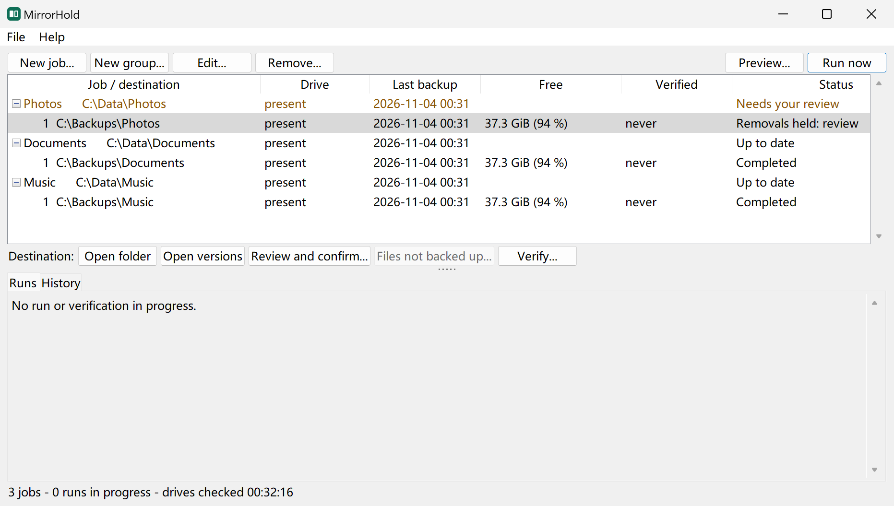
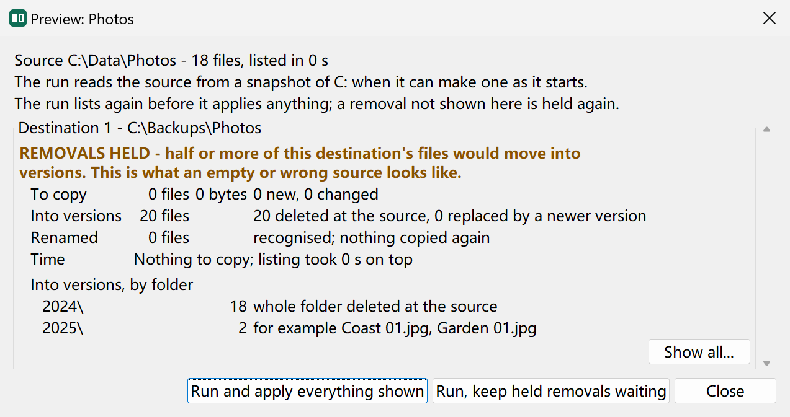
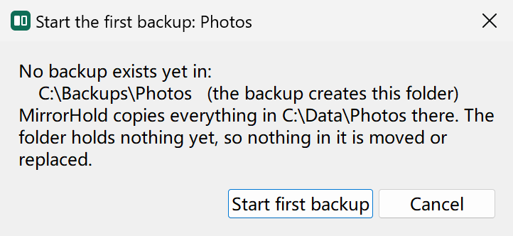
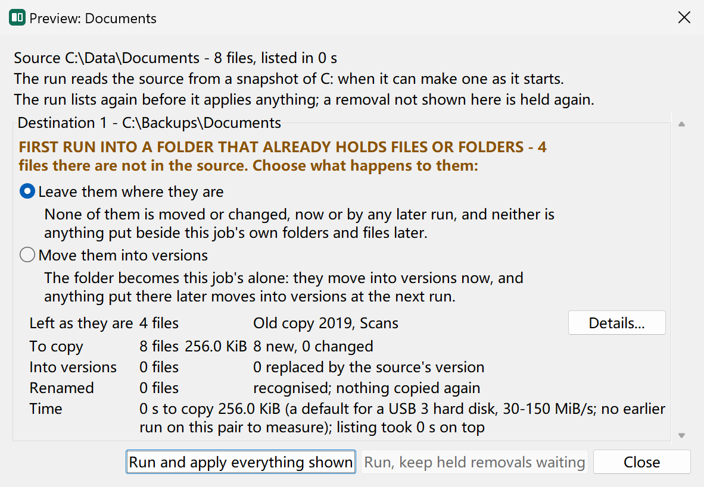
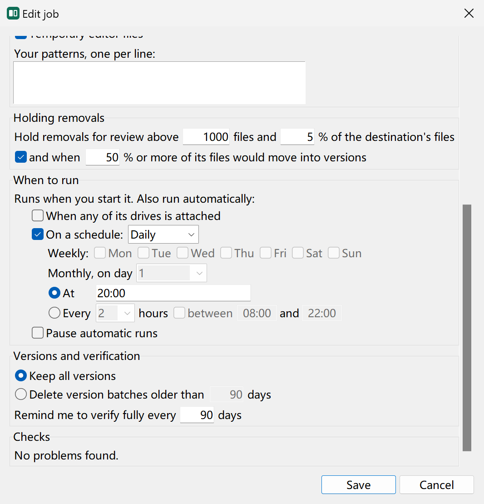
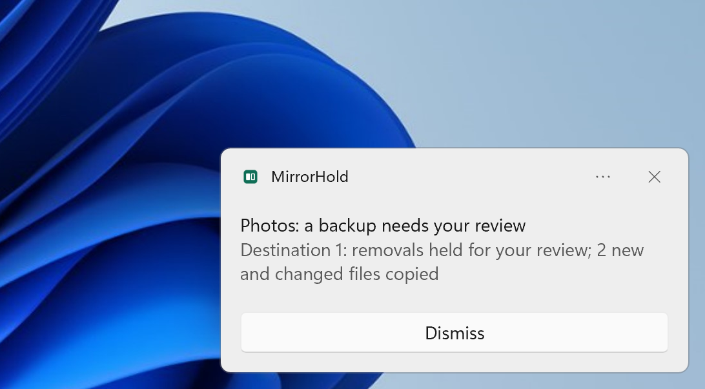

# MirrorHold

MirrorHold keeps one-way copies of your folders and drives on backup drives, on
Windows. A job copies one source — a folder or a whole drive — to one or more backup
drives: when you start it, when one of its drives is attached, or on a schedule. A backup
can also go to a folder of a cloud store you have set up in rclone
([Backing up to a cloud store](#backing-up-to-a-cloud-store)).

A plain mirror is not a backup. It copies an accidental deletion, a folder of encrypted
files or an empty, mis-mounted source straight into the copy. MirrorHold is built
around the safety checks that stop that from happening. The copying itself is done by
[rclone](https://rclone.org), pinned to one tested version.

> **Status.** Provided as is, with no promise of maintenance or support (see
> [Feedback](#feedback)). Windows only: tested on Windows 11 version 22H2, 64-bit.
> Versions make no promise of compatibility with one another's files.

## What it guarantees

- **Your sources are never changed.** MirrorHold only reads them.
- **Nothing on a backup drive is destroyed.** Every file a run would delete or overwrite
  on a backup drive is moved into that drive's versions folder instead. The one
  exception is version cleanup, and only when you switch it on for a job: it deletes
  version folders older than the number of days you choose.
- **The right drive, or none.** A backup drive is recognised by its partition and file
  system identity, never by its drive letter or label, and by a marker its first run
  leaves on it. A reformatted drive or a clone is never written to, and a folder that
  belongs to another job is refused.
- **Large removals wait for you.** A first run waits for your confirmation: into a folder
  that holds nothing yet, one question; into a folder that already holds files, a preview,
  where you choose whether what is already there stays where it is — the default — or
  moves into versions. Moving is not offered where the folder holds one another program
  synchronises, another job's source, or what Windows or MirrorHold needs, and a backup
  that would write into such a folder or move it into versions stops with nothing touched;
  exclude that folder from the job and it is left where it is while the backup goes on.
  What stays is never touched by that job, and neither is anything put beside the job's own folders and
  files later. Should the folder's record of what stays be lost, its next run waits for the
  same review, and whatever the source does not hold stays where it is. A run holds its removals when they number more than the
  larger of 1,000 files and 5 per cent of the backup's files, when they reach half of the
  backup's files (all three adjustable per job, and the last one can be switched off for a
  job of one or a few files, where a single edit is already half), or, whatever the job's
  values, when a changed file no longer looks like its file type, as encrypted files do.
  It still copies the new files; the held removals wait until you review and confirm them.
- **Busy files are read from a snapshot when possible.** A run reads its source from a
  Windows volume snapshot, so files other programs hold open are backed up as they were
  at one instant. Making one needs administrator rights. A drive that already holds
  snapshots of its own, such as Windows' restore points, gets one only while the space
  Windows keeps for snapshots there has plenty to spare, and is read as it is otherwise:
  when that space fills, Windows deletes the oldest snapshots, yours among them. A file a
  run cannot back up is reported, run after run.
- **You can check a backup.** *Verify* reads every file on both sides and compares
  their contents. It reports differences and changes nothing, because it cannot tell
  which copy is the damaged one. On a large backup that takes hours, so for a routine
  check *New copies only* reads just the files backed up or changed since they were last
  verified; only a full verification finds a copy damaged on its drive since it was read,
  and the reminder counts full verifications alone. A verification that stopped before the
  end shows in the list how far it got, and *Continue verification* (right-click the
  backup) takes it up from there.
- **You can replace damaged backup copies.** When you trust your source's copies,
  *Replace backup copies...* — on the verification's details, or right-click the backup —
  replaces the backup copies it found to differ: each moves into the backup's versions
  first, your source's copy is copied in its place, and both are read back to check they
  now match. A file changed since the verification, gone from either side, or whose source
  copy no longer looks like its file type, is left as it is.

All of this holds for a backup in a cloud store too; what differs there — how its copies are
checked, among other things — is under [Backing up to a cloud store](#backing-up-to-a-cloud-store).

## What it looks like



*The main window: most of the Photos source went missing, so its run holds the removals for review.*



*The review of those removals: half or more of the backup would move into versions.*



*A first backup into a folder that holds nothing yet: one question.*



*A first run into a folder that already holds files: leave them where they are, or move them into versions.*



*The job editor: when a run holds its removals, and when the job runs.*



*The notification of the run that held the removals.*

## Download and start

A release comes as a setup program and as a zip. Both carry everything MirrorHold needs,
Python and rclone included; the setup program installs it for you, and the zip runs where
you unpack it and installs nothing.

1. From the [releases page](https://github.com/offcutworks/mirrorhold/releases),
   download `MirrorHold-<release>-setup.exe` and `SHA256SUMS`.
2. Check the download. In PowerShell, in the folder you saved both to, run
   `Get-FileHash .\MirrorHold-<release>-setup.exe`: the hash it prints must be the one
   `SHA256SUMS` gives for that file. If it is not, delete the file.
3. Double-click the setup program and choose *Install*. It installs MirrorHold for you
   alone, needing no administrator rights, into `%LOCALAPPDATA%\Programs\MirrorHold`, and
   sets it up: a *MirrorHold* entry in the Start menu, and the scheduled tasks your jobs'
   automatic runs need ([Automatic runs](#automatic-runs)). MirrorHold is then listed
   among Windows' installed apps, and the setup program's last page offers to open it.

Where MirrorHold cannot be set up — it is installed from source on this account, say — the
setup program says why in MirrorHold's own words and leaves nothing installed.

**Or the zip.** Download `MirrorHold-<release>.zip` and `SHA256SUMS`, check the zip as in
step 2, and unpack it (right-click it, *Extract All...*) into a folder where it will stay —
the Start menu entry and automatic runs start it from there. Open the unpacked folder and
double-click *MirrorHold* (`MirrorHold.exe`).

**The Windows warning on the first start.** MirrorHold is not signed with a certificate,
and Windows SmartScreen warns before it runs a downloaded program it does not know: a
window titled *Windows protected your PC* says that it prevented an unrecognised app from
starting, and offers only *Don't run*. Choose *More info*: it names the application,
`MirrorHold.exe`, from an unknown publisher, and adds *Run anyway*. Choose that only for a
zip you downloaded from the releases page and checked as in step 2. The setup program is
not signed either, and the same warning may meet it: the same answer holds for a setup
program you downloaded from the releases page and checked.

## Your first backup

Create a job with *New job...*: a source folder or drive, typed or chosen, and one or more
backup folders, each on a backup drive — a backup folder that does not exist yet is made by
the first backup. A file is refused as the source, and so is a backup folder
that is itself one Windows or MirrorHold needs, such as your user folder: choose a folder
of its own. A backup folder inside one a cloud client keeps on every computer of your
account — OneDrive's, or Google Drive's My Drive in mirror mode — is refused too. One
inside a folder of this computer that Google Drive for desktop keeps a copy of in its
cloud is allowed, with a notice when you make the job and in every preview: Drive may put
back what a run moves into versions, and the next preview then names what reappeared,
which its run moves into versions again. Start the job with *Run now*. A first backup
never starts without you:

- into a backup folder that holds nothing yet, MirrorHold asks once, and starts when you
  choose *Start first backup*;
- into one that already holds files, the first run waits until you have looked at what
  it would do with *Review and confirm...*, chosen whether what is already there stays
  where it is (the default) or moves into versions, and confirmed it.

Every later run holds the removals listed under [What it guarantees](#what-it-guarantees)
until you review them in the same way.

## Backing up to a cloud store

A backup folder can be a folder of an rclone *remote*: rclone's name for a cloud account, a
bucket of an object store or a server, which you make with rclone itself. MirrorHold never
signs in to a service and never makes or changes rclone's configuration; it hands rclone the
configuration file you name, and rclone does the rest.

**Make a remote.** A release carries rclone in `vendor\rclone-v1.75.1-windows-amd64\`, and so
does a copy run from source once rclone is fetched; any rclone of your own works as well. In
PowerShell, in that folder, run

```
.\rclone.exe config
```

and follow its questions for your service; [rclone's documentation](https://rclone.org/docs/)
covers each one. Unless you choose another file, rclone keeps the remotes, and the sign-ins
they need, in `%APPDATA%\rclone\rclone.conf`.

**Name it in MirrorHold.** In *Preferences*, under *Remote destinations*, name that file as
the *rclone configuration*; *Check* lists the remotes in it. Then, in a job, add a
destination, choose *Folder of a remote*, choose the remote, and type a folder of it or
browse to one. A folder that does not exist yet is made by the first backup. On the command
line, `add --remote-dest REMOTE:FOLDER` does the same.

**Which remotes.** A remote is accepted when its service keeps modification times to two
seconds or finer and can move a file within itself, since every file a run would delete or
overwrite moves into the backup's versions there. MirrorHold asks rclone what the remote can
do when you add it, and refuses one below that, saying why.

**An SFTP server's key.** rclone checks the key an SFTP server shows only when the remote
tells it how: with `known_hosts_file`, naming OpenSSH's own file or one of your own, or with
the key it pins in the remote when you run, once,

```
.\rclone.exe --sftp-pin-host-key lsd REMOTE:
```

Without either, any server answering at the remote's address is taken for yours, and a
remote that signs in with a password sends that password to it; rclone warns of this each
time it reaches the remote. [rclone's SFTP documentation](https://rclone.org/sftp/#host-key-validation)
describes both ways.

**Lock the configuration.** An rclone configuration is plain text unless you encrypt it: a
service's sign-in token is written in clear, and a password only obscured, which rclone
itself calls reversible. Anyone who can read the file can use your accounts. To encrypt it,
run

```
.\rclone.exe config encryption set
```

Automatic runs then need it unlocked without asking you. Choose one of these under *Remote
destinations*:

- *Remember its password*: MirrorHold keeps the password sealed for your Windows account,
  opened only to check it as you save it and to hand it to rclone. It is off unless you
  choose it.
- *A command prints it*: a command of your own, such as one that reads the password from
  your password manager, prints it to rclone.

With *No password*, an encrypted configuration cannot be opened and a run that needs it stops
and says why. **Keep the password somewhere else too.** A password only Windows remembers is
lost if Windows loses your account's keys — when an administrator resets your account's
password, for one — and with it the configuration, and any backup the configuration
encrypts.

**What leaves your computer.** The service receives every file's content, name and
modification time, the folders, and the backup's `.mirrorhold` folder: the marker, the
versions, and copies of the job's definition — which names your source folder's path on this
computer — and of its run, verification and repair records, which name files. Anyone signed
in to the account can read all of it. To keep it from the service, make an rclone `crypt`
remote over your remote and back up to that: it encrypts the files' contents, and their
names too unless you choose otherwise, while their sizes, times and number and how the
folders nest stay visible. Whether to encrypt is your choice. MirrorHold accepts a remote
that does not encrypt, and says so in the job's editor, in every preview and in the list of
jobs.

**What differs from a backup drive.**

- A remote is never attached: a job runs onto it when its source's drive is attached, on its
  schedule, or when you start it. One that cannot be reached is skipped, and waits for the
  next run.
- Its free space is judged as its service reports it; a service that reports none is not
  judged.
- Runs, verifications and repairs that reach a remote always take turns with each other,
  since they share one configuration.
- *Verify* compares the fingerprint the service keeps of each file with your source's, and
  downloads nothing. Behind an encrypted remote rclone compares the encrypted form instead,
  where the service beneath keeps fingerprints; where no fingerprint can be compared, both
  copies are read, the remote's by download. A fingerprint shows the service still records
  the file as it was sent; damage the service did not record is not seen.
- A service that keeps deleted files in a trash frees no space at version cleanup until its
  trash is emptied; the cleanup's record says so.

## Automatic runs

A new job runs only when you start it. To have it run when one of its drives is
attached, or on a schedule, choose that in the job's *When to run* section. MirrorHold
must also be set up, which the setup program does as it installs it; a release from the
zip is set up once with *Preferences*, *Automatic runs and Start menu*, *Set up*. Being set
up is a *MirrorHold* entry in the Start menu and the Windows Task Scheduler tasks the jobs'
automatic runs need, in the folder `\MirrorHold`, all starting the copy that is set up
from its folder. Nothing stays running in the background but the icon of a reminder you have
not yet seen (below).

A schedule runs a job every day, on the weekdays you choose, or on one day of every month
(the 1st to the 28th, or the last day). On those days it runs at the times you list, up to
48, or every 1 to 12 hours, all day or between two times, which may run past midnight. A
run that falls while the computer is off runs at the next opportunity.

When a run ends it shows a Windows notification. You choose which ones in
*Preferences*. When a backup the run made is due a full verification (*Remind me to
verify fully every 90 days*, in the job), its notification says so too. Until MirrorHold
is set up, notifications appear under Windows PowerShell's name.

A notification that asks something of you stays on the screen until you close it: removals
held for review, a backup that did not finish or has files it cannot back up, a full
verification that found differences or did not finish, a repair that failed to replace or
left copies or did not finish, an automatic run that could not start. It also leaves a
reminder, which keeps MirrorHold's icon in the notification area until you have seen it
(below).

## Runs on one drive

Runs, verifications and repairs that need the same hard disk, to read from it or to write
to it, take turns: each waits until the one before it has finished, so that they do not
slow each other down. On a drive Windows reports as a solid-state drive, which has no
such slowdown, they run at the same time and share its speed, and so they do on a cloud
drive such as Google Drive for desktop's, which shares a connection rather than a disk. A
drive that does not say
what it is — as many USB drives do not, solid-state ones included — is taken for a hard
disk. A drive here is a disk, so two drive letters on one disk are one drive. A waiting
job says in the list its place in line, whom it waits for and the drive they share — *2nd
in line, waiting for 'Work' (drive I:)* — and the *Runs* tab says the same. Under *Runs on
one drive* in *Preferences*, *Automatic* is this behaviour; choose *Always one at a time*
to have them take turns on every drive, or *Always at the same time* to let them share
every drive. Runs on different drives run side by side unless they use the same folders.
Activities that reach a remote always take turns with each other.

Beneath the choice, *Preferences* lists each drive attached, with what Windows reports it
as, and each drive you have set that is not attached. Set a drive to *Hard disk*, *Solid-state
drive* or *Cloud drive* to say what it is — a USB solid-state drive Windows says nothing of,
say, or a cloud service's drive that is not recognised as one — and
*Automatic* goes by what you set rather than by Windows. What you set stays with the drive
whatever its letter or port, and is lost if the disk is partitioned anew.

## While a run, verification or repair works

MirrorHold keeps the computer from going to sleep by itself while a run, a verification
or a repair works: the computer's own sleep timer waits until the work ends. Sleep from
the Start menu still works, and a run waiting for its turn or paused holds nothing. To let
the timer decide, untick *Keep the computer from going to sleep* in *Preferences*.

While the work goes on, MirrorHold also asks Windows' shutdown screen to name it and offer to
cancel the shutdown, so a shutdown waits for you to choose *Shut down anyway* or *Cancel*. If
the work ends first, MirrorHold stops holding the shutdown up, and work a shutdown cuts
continues at its next run. To shut down without being asked, untick *Show it on Windows'
shutdown screen* in *Preferences*.

Whoever started the work — you, a schedule or a drive's arrival — MirrorHold's icon sits in
the notification area while it goes on, its outlined block, the copy, filling as the work
progresses and its tile turning grey while the work is paused. Point at it to see what works
and how far. Click it to open MirrorHold, or to bring forward the window already open;
right-click it to pause, resume, cancel or stop each run, verification or repair, with the
questions the *Runs* tab asks. The icon goes a few seconds after the last one ends, unless
the work left a reminder: the icon then stays, its tile amber, and pointing at it or
right-clicking it shows what to look at, until you open MirrorHold, bring its window to the
front, or dismiss it in the icon's menu. Nothing starts with Windows, so a reminder
left before a restart shows again with the next run, verification or repair. Windows may at
first keep the icon among the hidden icons, behind the arrow at the edge of the notification
area, until you choose to show it.

## Updating

Run a newer release's setup program and choose *Update*. It replaces the installed files
in place, leaving no file of the older release, and MirrorHold stays set up as it was.
While MirrorHold is at work — its window open, or a run, a verification or a repair going
on — it changes nothing and says so: close the window, let the work end or cancel it, and
choose *Back* to try again.

A release from the zip: unpack the newer one into a folder of its own and open it. It
reads the same jobs, and as it opens it asks whether to use it instead of the release that
is set up: choose *Use this copy*, then delete the older release's folder.

## Removing it

Installed with the setup program: remove *MirrorHold* from Windows' list of installed
apps. It asks first, then removes the Start menu entry, the scheduled tasks and the
program's folder. While MirrorHold is at work it removes nothing and says so. Where another
copy is the one set up — a release from the zip you chose to use instead — that copy's
Start menu entry and tasks stay.

A release from the zip: *Preferences*, *Remove* takes away the scheduled tasks and the
Start menu entry; then delete the release's folder.

Either way, your jobs and their records stay in `%LOCALAPPDATA%\MirrorHold` until you
delete that folder too, and your backups stay on their drives.

## Where things are kept

- `%LOCALAPPDATA%\MirrorHold` holds your jobs and preferences, the records of runs,
  verifications and repairs, live status and the logs they keep of what they did
  (`logs\`) — never the
  release's own folder, so deleting a release loses none of it. Run
  from source (below), the same files are in `Config\` beside the program.
- The setup program installs MirrorHold itself in `%LOCALAPPDATA%\Programs\MirrorHold`,
  which an update replaces and removing it deletes: nothing of yours is kept there.
- *File*, *Save history...* saves what the History tab shows — one job's runs, a
  group's, or every job's when nothing is selected — as a CSV file a spreadsheet opens;
  *Save log...* saves every log as one text file. Both go only where you choose.
- Each backup drive holds a hidden `.mirrorhold` folder at the job's destination: the
  marker, the versions (`versions\<date and time>\`, with the original folder
  structure), copies of the job's definition and of the run, verification and repair records,
  and, where the job left what the folder already held, the record of what is its own. A
  folder of a remote holds the same `.mirrorhold` folder.
- Where you chose to have the rclone configuration's password remembered, it is sealed in
  `remote-password.dpapi`, beside your jobs. MirrorHold keeps nothing else of the
  configuration: not a copy, only its path.

## Command line

Everything the window does is also a command, run in the release's folder —
`%LOCALAPPDATA%\Programs\MirrorHold` where the setup program installed it:

```
runtime\python -m mirrorhold --help
```

## Limits

- Scheduled tasks run only while you are logged on; a drive attached before you log on
  is served when you do.
- Snapshots need administrator rights. Without them a run reads its source as it is,
  and a file another program holds open without sharing is skipped and reported.
- A FAT32 backup drive cannot hold a file of 4 GiB or more; such a run stops before it
  copies anything.
- A few file names cannot be kept under their own name — one ending in a space or a
  period, among others. They are not backed up, and every run reports them.
- Network shares are not supported, as sources or as backup drives, and a remote is a
  backup folder only, never a source.
- Remotes were tested against rclone's own S3, WebDAV and SFTP servers on the computer
  itself, and its local and encrypted remotes, never against a cloud service: a service's
  upload limits, request limits, time precision and trash are known only from running on it.
- MirrorHold knows the folders a cloud client synchronises from Windows' record of them,
  where OneDrive and every client built on Windows' Cloud Files interface register theirs,
  and from Google Drive for desktop's own list. A backup folder inside one another client
  synchronises without registering it is not recognised, and that client may write back
  into it.
- A run decides that a file changed by its size and modification time. Damage on a
  backup drive that keeps both is found only by a full verification (*Verify*).

[PROJECT.md](https://github.com/offcutworks/mirrorhold/blob/main/PROJECT.md) describes
the design, every rule above and its reasons in full.

## Other companies' products

MirrorHold is not affiliated with, endorsed by or sponsored by Microsoft, Google, rclone's
authors, the makers of StableBit DrivePool, Dropbox, Syncthing or Nextcloud, or any other
company or project whose product it works with; their names are used only to say what it
works with.

It relies on these behaviours of other products, which their makers do not document and
an update of theirs can change, and the part of MirrorHold that relies on one may then
stop working as described:

- **Google Drive for desktop's own list of the folders it synchronises**, a database in
  Drive's data folder, read to protect those folders. A list Drive changes is reported as a
  list that could not be read.
- **Google Drive for desktop's drive answering as a file system device**, by which it is
  taken for a cloud drive under *Runs on one drive*.
- **Windows' record of the folders cloud clients synchronise**, read from the registry key
  where OneDrive and every client built on Windows' Cloud Files interface register them,
  rather than through that interface.
- **Notifications shown under Windows PowerShell's identity** until MirrorHold is set up,
  which Windows registers for PowerShell, not for MirrorHold.
- **The events Windows logs when a volume device starts or is removed**, by which a
  scheduled task notices a drive's arrival.
- **StableBit DrivePool's pool folder at the root of each member disk**, by which a member
  disk is recognised and refused as a backup drive.

## Feedback

MirrorHold comes with no promise of maintenance, support or replies. Bug reports are
welcome as issues; they are read occasionally and may go unanswered. Feature requests
are not taken, and pull requests are not accepted: the project is developed elsewhere and
published here as snapshots. Report a security problem privately, with *Report a
vulnerability* on the repository's *Security* tab, rather than as an issue.

## Running from source

For developers, and for anyone who prefers to run the code as it is published here.

- Windows 11 (Windows 10 is expected to work but is untested), 64-bit.
- Python 3.14 or later from [python.org](https://www.python.org), with Tk, which the
  installer includes by default.
- About 100 MB for the pinned rclone, which a script downloads for you.

Put this folder where it will stay: automatic runs start a copy of the tool that is
built beside it. Open PowerShell in the folder and run:

```
python -m venv .venv
.venv\Scripts\python -m pip install -r requirements.txt
.venv\Scripts\python tools\fetch_engine.py
.venv\Scripts\pythonw main.py
```

The third line downloads rclone v1.75.1 from rclone's own server, checks it against the
pinned SHA-256 digests, and puts it in `vendor\`. If you already have the release file
`rclone-v1.75.1-windows-amd64.zip`, pass it with `--from` instead. The last line opens
the window. The command line is `.venv\Scripts\python -m mirrorhold --help`.

Automatic runs from source need an installed copy rather than *Set up*: *Install* in
*Preferences*, or

```
.venv\Scripts\python -m mirrorhold install
```

copies the tool into `installed\`, adds the *MirrorHold* Start menu entry and registers
the scheduled tasks, pointing at that copy. Install again after updating the files;
*Uninstall* in *Preferences*, or `python -m mirrorhold uninstall`, removes the tasks, the
Start menu entry and the installed copy, and nothing else. One account holds either a
release set up or an installation from source, not both.

The tests:

```
.venv\Scripts\python tests\run_all.py
```

The suite needs the pinned rclone in `vendor\`. It works in temporary folders and never
touches your jobs, Task Scheduler, notifications, the notification area or volume
snapshots. `PROJECT.md`, under *Building a release*, says how a release's zip and setup
program are built from a commit.

## License

MirrorHold is made by offcutworks and released under the [MIT License](LICENSE). A
release also carries rclone, Python with Tcl/Tk, and pywin32, each under its own license;
`THIRD-PARTY-NOTICES.txt` in the release's folder reproduces them, and *About* opens it.
The setup program is built with [Inno Setup](https://jrsoftware.org/), by Jordan Russell
and Martijn Laan.
Run from source, MirrorHold downloads rclone and runs it but does not include it: rclone
is released under the MIT License, copyright Nick Craig-Wood, and its license is in the
`README.txt` of its release folder.
